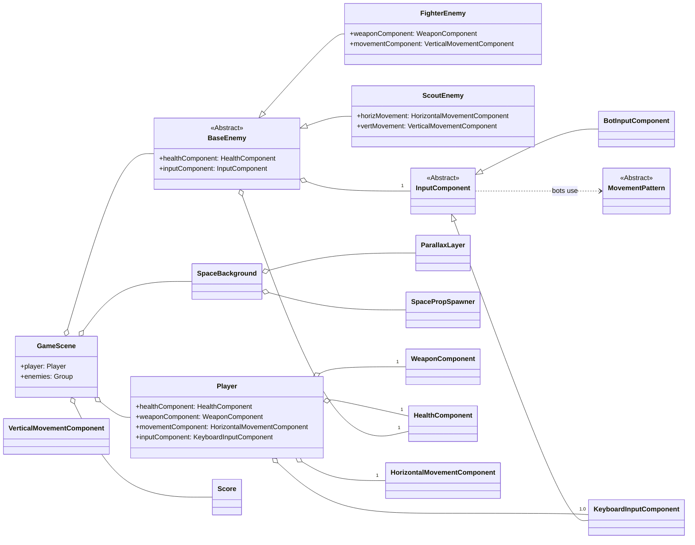

This document provides a detailed overview of the project's architecture, structure, and core components.

## High-Level Architecture

The game is built using the [Phaser 3](https://phaser.io/) framework and follows a modern JavaScript (ES6) component-based architecture. This design pattern promotes separation of concerns, making the code more modular, reusable, and easier to maintain.

The core architectural concepts are:

- **Scenes:** The game is divided into distinct scenes (`BootScene`, `PreloadScene`, `GameScene`, `PauseScene`, `GameOverScene`), each managing a specific part of the game loop (e.g., loading, gameplay, menus).
- **Game Objects:** These are the primary entities in the game, such as the `Player` and different `Enemy` types. They are composed of various components that define their behavior.
- **Components:** These are reusable modules that encapsulate specific functionalities like `Movement`, `Health`, `Weapon`, or `Input`. Game objects use these components to build their complete behavior.

## Folder Structure

The project is organized into the following main directories:

- **`/assets`**: Contains all game assets, including images, audio, and data files (like animation definitions).
- **`/src`**: The main source code directory.
  - **`/components`**: Houses all reusable components. Each sub-directory corresponds to a specific type of functionality (e.g., `collider`, `input`, `weapon`).
  - **`/lib`**: Contains the Phaser 3 framework library.
  - **`/objects`**: Defines the main game objects. It has sub-directories for `enemies`, `ui` elements and the `background`.
  - **`/scenes`**: Contains all game scenes.
  - **`/types`**: Holds type definitions for better code assistance and clarity.
  - **`/utils`**: Small helpers without game state (e.g. `viewport.js` computes the world height for the window shape).
  - **`config.js`**: A central configuration file for game constants like speed, health, and spawn rates.
  - **`main.js`**: The main entry point of the game, where the Phaser Game instance is created.

## Core Classes and Components

Below is a breakdown of the most important classes and their roles.

### Scenes

- **`BootScene.js`**: The very first scene to run. Its sole purpose is to load the assets required for the `PreloadScene`.
- **`PreloadScene.js`**: Loads all game assets (images, sounds, spritesheets) and creates all necessary animations. Once complete, it launches the `GameScene`.
- **`GameScene.js`**: The main scene where the actual gameplay occurs. It is responsible for:
  - Spawning the player and enemies.
  - Setting up physics and collision detection.
  - Managing the UI (score, lives).
  - Handling player input for pausing the game.
- **`PauseScene.js`**: A simple overlay scene that is launched when the game is paused. It displays a "Paused" message and waits for the player to resume.
- **`GameOverScene.js`**: Displayed when the player runs out of lives. It shows the final score and prompts for a restart.

### Game Objects

- **`Player.js`**: Represents the player's spaceship. It is composed of:
  - `KeyboardInputComponent`: Handles keyboard input for movement and firing.
  - `PlayerHorizontalMovementComponent` & `PlayerVerticalMovementComponent`: Manages the ship's movement.
  - `WeaponComponent` (two of them: main and secondary slot): Controls the firing mechanism and manages projectiles.
  - `PlayerLoadoutComponent`: Decides which weapon each `WeaponComponent` uses and at which level (see Weapons and Pickups).
  - `HealthComponent`: Tracks the player's health and lives.
- **`ScoutEnemy.js` & `FighterEnemy.js`**: Represent the two types of enemy ships. They are composed of similar components to the player, but with different configurations and AI-driven input components (`BotScoutInputComponent`, `BotFighterInputComponent`).

### Components

- **`InputComponent.js` (and its subclasses)**: Defines how a game object is controlled. `KeyboardInputComponent` reads from the keyboard, while bot components implement simple AI patterns.
- **`MovementComponent.js` (and its subclasses)**: Manages the velocity and position of game objects.
- **`WeaponComponent.js`**: A generic component for managing weapon systems, including firing rates, projectile pools, and bullet destruction.
- **`HealthComponent.js`**: Manages the health of a game object, handling damage and death events.
- **`ColliderComponent.js`**: Reacts to collisions. Besides damage it holds the shield charges of the player (`addShield`, absorbs hits, short `hitGrace` after each absorbed hit).
- **`EventBusComponent.js`**: A simple event bus used for communication between different components and game objects, decoupling them from each other.

### Weapons and Pickups

Enemies drop pickup boxes; the player's weapons are data in `config.js` and are swapped at runtime.

- **`PickupSpawnerComponent`** (`components/spawners/`): on `ENEMY_DESTROYED` rolls a drop (`DROP.chance` by enemy class name, kind by `DROP.weights`, weapon type from `DROP.mainWeapons` / `DROP.secondaryWeapons`) and owns the pooled boxes (`box_<kind>` frames of the `weapons` atlas). Boxes fall, spin, pulse, blink before they vanish. Touching one emits `PICKUP_COLLECTED {kind, type}`; the player applies it (heal, shield charges or `loadout.collect`). Regular enemies cannot drop again for `DROP.cooldown` ms after a drop (the boss always drops). Stops dropping after `GAME_OVER`.
- **`PlayerLoadoutComponent`** (`components/weapon/`): main slot `{type, level}` plus an optional secondary slot (rockets), and the level reached by every type for the whole run. The same type again gains a level (max `WEAPONS.maxLevel`), another main type replaces the weapon and returns at its remembered level. Builds a `BulletConfig` from `CONFIG.WEAPONS`, applies it with `WeaponComponent.setConfig` and emits `WEAPON_CHANGED {slot, type, level}`. On `PLAYER_DESTROYED` all weapons are lost: the main slot returns to the start weapon, the secondary slot is emptied, remembered levels reset.
- **`WeaponComponent`** takes per-weapon texture/frame, `scale`, `bodySize`, `damage`, `pierce`, `chain`, `hitEffect`; the bullet pool is sized once (`poolSize`) for the biggest level. Damage is stored on the bullet and passed to `ColliderComponent.collideWithEnemyProjectile(damage)` and `HealthComponent.hit(damage)`; piercing bullets hit each enemy once.
- **Hit handling**: `game-scene.js` `hitEnemyWithBullet` handles every player bullet group (main, secondary) against scouts, fighters and the boss and emits `BULLET_HIT {x, y, effect, enemy, chain, explosion}`. Listeners: `HitEffectComponent` (pooled `<weapon>_hit_1..4` animation), `ChainLightningComponent` (jagged arcs to the nearest unvisited enemies, 2 / 4 / 6 targets by level, targets come from a getter built in `game-scene.js`), `ExplosionComponent` (area damage for rockets).
- **`HomingComponent`**: steers rocket bullets toward the nearest enemy after a short straight flight and retargets when it dies.
- **Weapons:** main plasma (parallel streams), shotgun (fan), laser (fast piercing beams), lightning (chain); secondary rockets (1 / 2 / 4, homing, area blast). Atlas frames: `<weapon>_shot`, `<weapon>_hit_1..4`, `box_<name>`. The atlas is built from `assets/images/weapons/*.png` by `tools/build-weapon-atlas.py` (one-off, not part of the game).
- **UI:** `ui/weapon-slot.js` shows the icon and level pips of the main and the secondary slot above the lives; `objects/shield-effect.js` draws the shield bubble with a ripple on every absorbed hit. The player shows a popup text on every pickup and `AudioManager` plays a sound on `PICKUP_COLLECTED`.
- **`DifficultyComponent`** (`components/difficulty/`): counts game time (paused with the scene) and returns the current `DIFFICULTY.stages` entry. Enemies read it on every spawn (`reset()`): extra health (`healthBonus`) and the weapon preset of the stage (`ENEMY_WEAPONS`: acid, railgun, wider spreads, shot interval x `fireScale`); `EnemySpawnerComponent` scales its group interval by `spawnScale`. Enemy bullets carry `damage` (`BULLET_ACID` 1, `BULLET_RAILGUN` 2); the boss has a `snipe` railgun weapon and 300 health.
- **Config:** `WEAPONS` (types, levels, `debug`), `DROP` (chances, weights, `debug.forceAll`), `PICKUPS` (look, fall, lifetime), `SHIELD`, `CHAIN_LIGHTNING`, `UI_WEAPON_SLOT`, `AUDIO_PICKUP_VOLUME`.

### Viewport

World width is fixed (`GAME_WIDTH`), height follows the window shape and is clamped to `GAME_MIN_HEIGHT`..`GAME_MAX_HEIGHT`, so wide screens give no advantage. `utils/viewport.js` computes the height and the HUD safe area; `main.js` calls `scale.setGameSize` on window resize. Scenes listen to the Scale `resize` event and remove the listener on shutdown.

### Background

All textures are generated procedurally by `objects/background/space-textures.js` (no image files).

- **`ParallaxLayer`**: one seamless scrolling `TileSprite`; speed from `BACKGROUND_LAYERS`, movement scaled by `delta`.
- **`SpaceBackground`**: assembles the star layers and fast streaks, handles `update(delta)` and `resize(w, h)`. Speeds up while the player thrusts (`PLAYER_THRUST` event).
- **`SpacePropSpawner`** (`components/spawners/`): pooled planets and nebulae that drift and fade in/out.

### UI

`objects/ui/ui-style.js` is the single source of HUD text styles (Orbitron font, colors and sizes come from `UI_*` in `config.js`). `Score` shows zero-padded points with a pop effect and pooled floating "+N" text. `PauseScene` and `GameOverScene` use the same styles and re-center on resize.

### Enemy Behavior

`components/movement/movement-patterns.js` holds trajectory strategies (wave, zigzag, chase, dash decorator). Bot input components pick a pattern per enemy type and drive left/right flags from it. `WeaponComponent` supports angled shots, bursts and aimed shots via options. `EnemySpawnerComponent` can spawn formations (line, V). All parameters live in `config.js`.

### Rendering

Renderer is `Phaser.AUTO` (WebGL with Canvas fallback), `antialias` on. Loaded sprites use NEAREST filtering to stay crisp; procedural background textures stay smooth. Engines and bullets use additive blending.

## Game Flow

1.  **`main.js`** initializes the Phaser game with the scene configuration.
2.  **`BootScene`** loads minimal assets for the preloader.
3.  **`PreloadScene`** loads all game assets and defines animations.
4.  **`GameScene`** starts, creating the player, enemy spawners, and UI.
5.  The player controls their ship, and enemies are spawned periodically by `EnemySpawnerComponent`.
6.  Collisions are detected by the Phaser Arcade Physics engine.
7.  `HealthComponent` and `Score` components listen to events (like `ENEMY_DESTROYED`) to update the game state. `PickupSpawnerComponent` also listens to it and may drop a box; the ship picks it up and `PlayerLoadoutComponent` swaps or upgrades the weapon.
8.  If the player presses `ESC`, the `GameScene` is paused, and the `PauseScene` is launched.
9.  If the player loses all lives, the `GameScene` is paused, and the `GameOverScene` is launched.

## Conventions

- **New game objects** should be placed in the `/src/objects/` directory. If it's an enemy, it goes into `/src/objects/enemies/`.
- **New components** should be created in the relevant sub-directory under `/src/components/`.
- **Game-wide constants** (like stats, speeds, or scoring values) should be added to `src/config.js` to allow for easy tweaking.
- **File names** use `kebab-case.js`.

